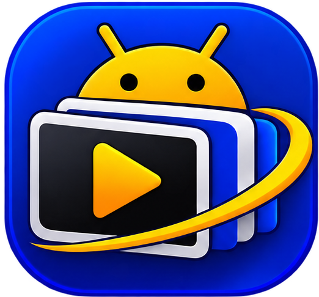

  

<h1 align="center">Cellcom ApkStart</h1>

  <b>Ejecutá apps Android en Windows como si fueran programas nativos.</b> 
  100 % en español latino · by <a href="https://www.cellcomweb.com.ar">Cellcom Technology</a>

  
  
  

---

## ¿Qué es?

**Cellcom ApkStart** es un lanzador de apps Android para Windows. Instalás un APK y la app aparece como un programa más: con su propio ícono en el escritorio y en el menú Inicio y su propia ventana, sin tener que abrir un emulador completo cada vez.

Por dentro usa un entorno Android virtualizado que se maneja solo. Arranca, se repara y se optimiza en segundo plano, así que no hace falta saber nada de emuladores.

## Características

- 🇦🇷 **Interfaz completa en español latino**: menús, diálogos, notificaciones, mensajes de error y el instalador.
- 📦 **Instalación de APK con un clic**, con acceso directo en el escritorio y en el menú Inicio para cada app.
- 🪟 **Dos tipos de ventana**:
  - *Integrado*: la imagen de Android se integra en la ventana de ApkStart.
  - *Independiente*: el emulador abre su propia ventana y maneja la rotación, el escalado y la entrada de forma nativa.
- ⚡ **Inicio rápido** con instantáneas: después del primer arranque, las apps abren en segundos.
- 🌎 **Android configurado para la región**: idioma es-419, zona horaria de tu PC y DNS 1.1.1.1 / 8.8.8.8.
- ⌨️ **Asignación de teclas** para controlar juegos y apps con el teclado.
- 🔄 **Rotación de pantalla**, varios tamaños de resolución y ajuste de densidad.
- 🧠 **Asignación de recursos**: elegís cuánta memoria, cuántos núcleos y cuánto espacio para datos le das a Android.
- 🛠️ **Diagnóstico y reparación automáticos**: detecta aceleración por hardware, runtime VC++, puertos ocupados, archivos de bloqueo, falta de espacio, problemas de red y más, y casi todo se arregla con un clic.
- 🧩 **Modo de compatibilidad ARM** (imagen Android 14 con Google Play) para apps que no corren en x86.
- 🧹 **Mantenimiento**: limpieza de imágenes viejas, restablecimiento de datos de Android y reparación de red sin perder las apps.

## Requisitos

| | Mínimo | Recomendado |
|---|---|---|
| Sistema | Windows 10 x64 | Windows 11 x64 |
| Procesador | 4 núcleos con virtualización (Intel VT-x / AMD-V) | 6 núcleos o más |
| Memoria RAM | 8 GB | 16 GB |
| Disco libre | 6 GB | 15 GB o más (SSD) |
| Otros | Microsoft Visual C++ 2015-2022 Redistributable (x64) | Plataforma del hipervisor de Windows activada |

> **Importante:** la virtualización tiene que estar activada en la BIOS/UEFI. Sin aceleración por hardware el programa funciona igual, pero con emulación por software, que es muchísimo más lenta.

## Descarga e instalación

1. Andá a **[Releases](../../releases/latest)** y descargá `Cellcom-ApkStart-Setup-x.x.x.exe`.
2. Ejecutá el instalador y seguí los pasos.
   - Si Windows SmartScreen muestra «Windows protegió su PC», hacé clic en **Más información → Ejecutar de todas formas**. Aparece porque el ejecutable no tiene firma digital comercial.
3. Abrí **Cellcom ApkStart** desde el escritorio o el menú Inicio.
4. La primera vez, el asistente prepara el entorno:
   - Motor del entorno: unos **440 MB**.
   - Imagen de sistema Android: unos **1,5 GB**.

   Según tu conexión puede tardar varios minutos. Es solo la primera vez.

> 💡 Si tenés antivirus, agregá la carpeta de instalación y la carpeta de datos del entorno a las exclusiones. Algunos antivirus borran componentes del emulador por error.

## Uso

### Instalar una app
1. Hacé clic en **Instalar APK** y elegí el archivo `.apk`.
2. Esperá a que termine la instalación. La app aparece en la lista y en el escritorio.
3. Abrila con doble clic. La primera vez el entorno se precarga y tarda un poco más.

### Iniciar Android sin abrir una app
El entorno arranca automáticamente al abrir cualquier app. Para tener el escritorio completo de Android, instalá un launcher (por ejemplo **Lawnchair**, **Nova Launcher** o **KISS**) como si fuera una app más y abrilo desde ApkStart. Funciona mejor con **Configuración → Tipo de ventana → Ventana independiente**.

### Opciones útiles (Configuración)
- **Tipo de ventana**: integrado o independiente.
- **Tamaño de la imagen**: 720×1280, 900×1600, 1080×1920 o 1440×2560. Cuanto más chico, menos recursos usa.
- **Orientación del panel**: automática, vertical u horizontal.
- **Recursos**: memoria, núcleos y tamaño de la partición de datos.
- **Carpeta de datos del entorno**: movela a otro disco si te quedás sin espacio.
- **Diagnóstico del entorno**: revisa todo y ofrece botones de **Reparar**.

## Solución de problemas

| Problema | Solución |
|---|---|
| Arranca muy lento | Activá *Plataforma del hipervisor de Windows* desde **Configuración → Diagnóstico → Reparar** (pide permisos de administrador) y reiniciá la PC. |
| Error `0xc0000135` | Falta el runtime de VC++. Instalá [Microsoft Visual C++ 2015-2022 Redistributable (x64)](https://aka.ms/vs/17/release/vc_redist.x64.exe). |
| Pantalla negra o la app no carga contenido de Internet | **Configuración → Reparar red**. Primero intenta un arranque en frío sin tocar tus datos. |
| «AVD ya en uso» / archivos de bloqueo | ApkStart los limpia solo. Si se repite, cerrá otros emuladores (BlueStacks, MuMu, NoxPlayer, MEmu) o reiniciá la PC. |
| Puerto ocupado | Cerrá otros emuladores. ApkStart elige otro puerto automáticamente. |
| Poco espacio en disco | Cambiá la carpeta de datos del entorno a otro disco o desactivá *Conservar instantánea de inicio rápido*. |
| Imagen corrupta, bordes negros o toques desfasados | Cambiá a **Ventana independiente**. |
| Falla con rutas con acentos | Instalá en una carpeta sin acentos ni símbolos, por ejemplo `C:\ApkStart`. |
| Una app no abre (solo ARM) | Activá el **Modo de compatibilidad ARM** y descargá la imagen con Google Play. |

Si el entorno no arranca después de varios intentos, ApkStart genera un **informe de diagnóstico**. Adjuntalo cuando reportes el problema.

## Preguntas frecuentes

**¿Es gratis?** Sí.

**¿Necesito una cuenta de Google?** No. Solo la necesitás si usás el modo ARM con Google Play y querés descargar desde la tienda.

**¿Se actualiza solo?** No. Las actualizaciones automáticas están desactivadas; las versiones nuevas se publican en [Releases](../../releases).

**¿Pierdo mis apps si reparo la red o amplío el disco?** No. Solo *Restablecer datos de Android* borra las apps instaladas, y siempre pide confirmación antes.

**¿Puedo usarlo junto con BlueStacks u otro emulador?** Sí, pero no al mismo tiempo, porque compiten por la virtualización y los puertos.

## Soporte

- 🌐 Web: [www.cellcomweb.com.ar](https://www.cellcomweb.com.ar)
- 🐞 Errores y sugerencias: [Issues](../../issues)

## Créditos y licencia

Cellcom ApkStart es una versión traducida y adaptada por **Cellcom Technology**, basada en [ApkStart](https://github.com/RoutineMiku/ApkStart) de RoutineMiku, distribuido bajo la **licencia MIT**.

Este proyecto se distribuye con la misma licencia. Consultá el archivo [LICENSE](LICENSE).

Android es una marca registrada de Google LLC. Este proyecto no está afiliado a Google ni a Microsoft.

---

Hecho en Argentina 🇦🇷 por <a href="https://www.cellcomweb.com.ar">Cellcom Technology</a>

